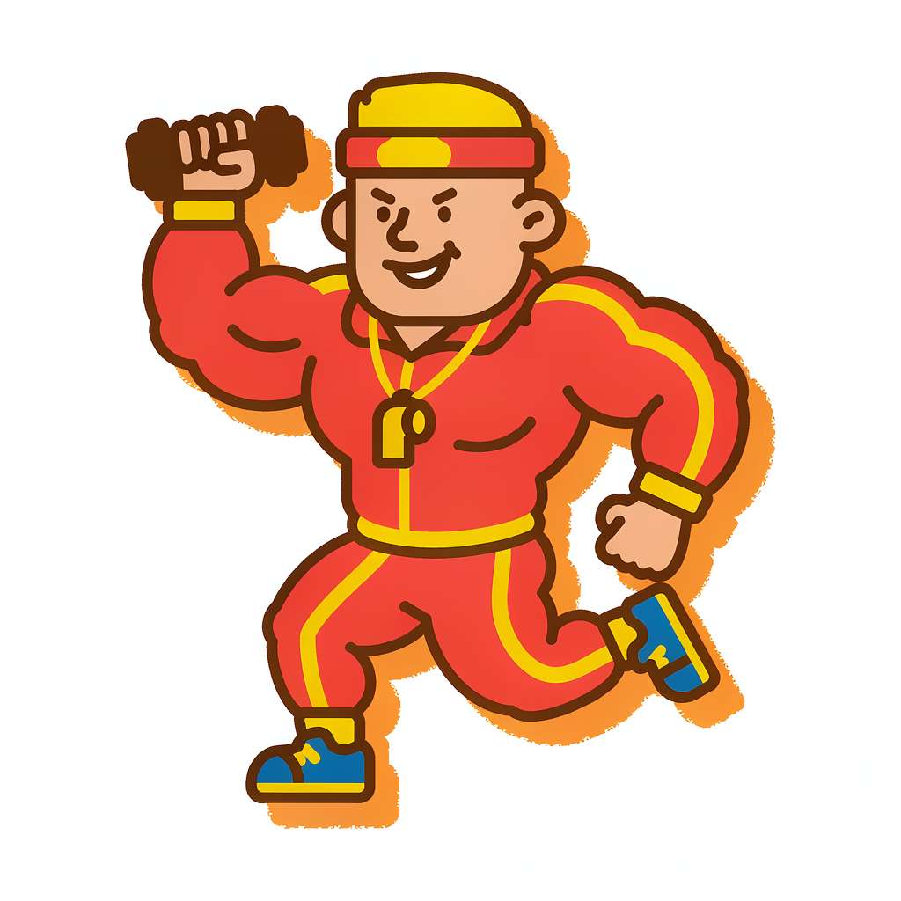

# 🍟 麦门杠精天团 McAtheists


> 市面上所有 AI 都在帮你更快地点麦当劳，只有这一届，会拦着你。

想吃巨无霸？先过五关。**麦门杠精天团**是一支反向下单守门团——每位杠精都武装着你的真实数据（营养表、点单记录、优惠券、积分），想吃，先跟他们辩。

**辩赢了**：全员认输，立刻变脸为最强点餐助理，双向查券帮你算出全场最优价下单。
**辩输了**：你会收到一张《劝退卡》，本单金额自动存入"巨无霸基金"。

怎么都是它赢。

## 🎭 天团阵容

| 立绘 | 杠精 | 数据武器 | 杀伤力 |
|---|---|---|---|
|  | 🏋️ **铁面私教·铁蛋** | 餐品营养数据（热量/脂肪/钠） | 你这周的训练量，配得上这 550 大卡吗 |
|  | 💼 **财务总监·钱总** | 你的历史订单账本 | 本月第 4 次了，请从投资回报率角度论述本次消费 |
|  | 💔 **前任·小艾** | 你的点单旧账 | 你上次说"最后一次"的时候，也是点的这个 |
|  | 🎣 **钓鱼佬·老六** | 今日活动日历（反向劝进） | 今天买一送一，不吃是损失——说吧，是饿还是馋 |
|  | 👔 **甲方·王总** | 你的积分与持券情况 | 这个"想吃"是刚需还是伪需求，先对齐颗粒度 |

*每次出战 3 名（深夜自动加入前任，发薪日加入财务总监）。想打满级？说"我要打满级"。*

## 🎮 一局怎么玩

```
你：我想吃巨无霸
天团：检测到麦门冲动。今日守关：铁蛋、钱总、老六。
────
铁蛋：550 大卡，脂肪 26 克。同学，先报下这周训练量。
你：今天练了腿，深蹲 5×5。
铁蛋：……行，这关你过。明天多加两组深蹲当学费。
────
钱总：本月第 2 次，预算内。会计学得不错，我签字。
────
老六：今天麦旋风买一送一！说不清是饿还是馋就别过我这关。
你：没吃晚饭，真饿。
老六：真爱饿啊。别用券了，我给你找最快出餐的店。
────
全员：我们输了。滴——已切换最强点餐模式。
（查门店可用券 × 你的持券 → 算出券后最优价 → 交付支付链接 + 《通关卡》）
```

没扛住想放弃？收到《劝退卡》：本单 ¥39.5 已存入巨无霸基金，累计被劝退 7 次，省下 ¥412。

## ⚡️ 安装（WorkBuddy）

**前置**：在 [open.mcd.cn/mcp](https://open.mcd.cn/mcp) 申请麦当劳 MCP Token（免费，手机号登录即得）

1. 把本仓库 clone 到你的 WorkBuddy 技能目录：

```bash
git clone https://github.com/{你的用户名}/mcd-gangjing.git ~/.workbuddy/skills/mcd-gangjing
```

2. 配置麦当劳 MCP（参照仓库内 `mcp-config.example.json`，Token 替换为你自己的）：

```json
{
  "mcpServers": {
    "mcd-mcp": {
      "type": "streamablehttp",
      "url": "https://mcp.mcd.cn",
      "headers": {
        "Authorization": "Bearer YOUR_MCP_TOKEN"
      }
    }
  }
}
```

3. 在 WorkBuddy 连接器管理中启用 mcd-mcp，然后直接说：

> 我想吃麦乐鸡

天团自动开庭。

## 🧰 技术架构

- **形态**：WorkBuddy Skill（纯提示词工程 + MCP 工具编排，零后端代码）
- **数据底座**：麦当劳 MCP 官方 Server（`https://mcp.mcd.cn`）的 8 个工具
- **战绩系统**：本地 JSON 档案（`mcd-gangjing-data/battle-log.json`）累计被劝退/省下金额
- **传播物料**：自动生成《劝退卡》《通关卡》HTML（480px 手机截图友好）

工具编排细节见 [MCP_INTEGRATION.md](./MCP_INTEGRATION.md)，杠精人设见 [references/personas.md](./references/personas.md)。

## 👥 适合谁

- 每次点完麦当劳都说"最后一次"的麦门信徒
- 想吃麦麦但正在减脂/攒钱的摇摆人
- 觉得 AI 助手太听话、想找个 AI 跟自己对线的受虐爱好者
- 想体验"AI 帮我拦住我自己"这一新物种的尝鲜党

## 🗺️ Roadmap

- [ ] 每周战绩周报《麦门戒律报告》
- [ ] 杠精天团扩编：深夜电台主播、体检报告解读员
- [ ] 劝退卡样式商店（麦麦联名周边风）

## ⚖️ 声明

本项目为麦当劳程序员节创意开发大赛参赛作品，非麦当劳官方产品。餐品信息、价格及供应状态以麦当劳官方渠道实时结果为准。杠精言论纯属娱乐，不构成营养或消费建议——被劝退省下的钱记得请自己吃顿好的。

## 🏆 参赛信息

- 麦当劳程序员创意开发大赛 · 1024 程序员节
- 使用 WorkBuddy + 麦当劳 MCP 开发，完整开发对话见 [workbuddy.md](./workbuddy.md)

觉得好玩就点个 ⭐ 吧——你的每一个 Star，都是给天团的续约奖金。
